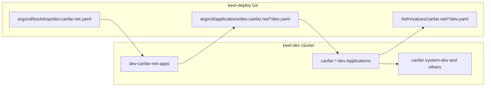

# Adding the canfar.net `dev` environment (keel-dev)

This guide is for operators who extend **CANFAR on `dev.canfar.net`**: a **development** environment that runs on the **keel-dev** Kubernetes cluster, not on keel-prod. Git in this repository is the source of truth; Argo CD syncs Helm releases from Harbor (or in-repo charts) plus value overlays from `helm/values/canfar.net/`.
While this guide is focused on `dev`, it will apply to any environment that requires a separate cluster.

Use this document when you:

- Bootstrap dev on a new keel-dev cluster (one-time).
- Add **another service** to dev (most day-to-day work).
- Onboard a new team member — start with [Worked example: `reg`](#worked-example-reg-complete-reference), then [Exercise: ship `access`](#exercise-ship-access-values-already-exist).

## How dev relates to staging and production

| Concept | Staging / production | Dev |
| ------- | -------------------- | --- |
| **Cluster** | **keel-prod** | **keel-dev** (separate control plane) |
| **Public hostname** | `staging.canfar.net`, `canfar.net`, … | `dev.canfar.net` |
| **Helm values path** | `helm/values/canfar.net/<service>/staging.yaml`, `prod.yaml`, … | `helm/values/canfar.net/<service>/dev.yaml` (same domain folder as prod) |
| **Argo `Application` path** | `argocd/applications/canfar.net/<service>/` | `argocd/applications/dev.canfar.net/<service>/dev.yaml` |
| **App-of-apps parent** | `canfar-net-apps` → `argocd/applications/canfar.net/` | `dev-canfar-net-apps` → `argocd/applications/dev.canfar.net/` |
| **Typical workload namespace** | `canfar-system-staging`, `canfar-workloads`, … | `canfar-system-dev` (exceptions documented per service) |
| **Bootstrap manifest** | `argocd/bootstrap/canfar.net.yaml` (apply on **prod only**) | `argocd/bootstrap/dev.canfar.net.yaml` (apply on **keel-dev only**) |

Dev is an **environment** of the same product (`canfar.net`), not a second copy of the values tree. Values always live under `helm/values/canfar.net/`. Only the Argo **Application** manifests sit under `argocd/applications/dev.canfar.net/` so the keel-prod parent never tries to deploy dev workloads onto prod.



## Current rollout status (Git)

Track what is already in this repo when you plan work. Update this table when you merge new services.

| Service | `helm/.../dev.yaml` | `dev.canfar.net/.../dev.yaml` | Notes |
| ------- | ------------------- | ----------------------------- | ----- |
| reg | yes | yes | Canonical Harbor + values pattern |
| comet | yes | yes | Chart from this repo (`helm/charts/canfar.net/comet`); see [Special cases](#special-cases) |
| access | yes | **no** | Good first exercise — values only, add the Application |
| skaha, arc, science-portal, web-portal, web-root, storage-ui, … | no | no | Copy from staging/prod following the checklist below |

## Prerequisites (before you open a PR)

1. **kubectl** context points at **keel-dev** when you apply bootstrap or create secrets (never apply `dev.canfar.net.yaml` on prod).
2. **Argo CD** is installed on keel-dev; this repository and Harbor/OCI sources are registered ([root README prerequisites](../README.md#prerequisites-operators)).
3. Namespace **`canfar-argocd`** exists and Argo can manage `Application` CRs there (same as prod canfar.net).
4. **DNS / ingress** for `dev.canfar.net` reaches the dev cluster ingress controller.
5. **Secrets** in the destination namespace **before** the first sync (see [Secrets](#secrets-before-first-sync)).

Cluster-level **Kueue** objects for dev use `manifests/kueue/**/dev.*.yml` and are applied by a **separate** operator ApplicationSet, not by the canfar.net app-of-apps. Skaha and session workloads depend on that layer; see [Kueue on keel-dev](kueue.md#development-cluster).

## One-time: bootstrap dev on keel-dev

If `dev-canfar-net-apps` already exists in Argo on keel-dev, skip this section.

1. Edit [`argocd/bootstrap/dev.canfar.net.yaml`](../argocd/bootstrap/dev.canfar.net.yaml): set `spec.source.repoURL` (and `targetRevision` if needed) to this repository.
2. On **keel-dev** only:

   ```bash
   kubectl config use-context <keel-dev-context>
   kubectl apply -f argocd/bootstrap/dev.canfar.net.yaml
   ```

3. In the Argo CD UI (or CLI), sync **`dev-canfar-net-apps`**. It recursively discovers every `Application` under `argocd/applications/dev.canfar.net/`.

Do **not** add dev Applications under `argocd/applications/canfar.net/` — the prod parent `canfar-net-apps` would reconcile them on keel-prod.

## Checklist: add one service to dev

For each service that should run on `dev.canfar.net`:

### 1. Helm values overlay

Create `helm/values/canfar.net/<service>/dev.yaml` (or extend an existing file).

- Start from **`staging.yaml`** (or `prod.yaml` if staging does not exist).
- Replace hostnames and URLs with **`dev.canfar.net`** (ingress hosts, `registryURLs`, OIDC redirect URIs, `serviceEntries`, `ivo://` capability URLs, etc.).
- Keep shared tuning in **`base.yaml`**; only environment-specific deltas go in `dev.yaml`.
- Align keys with the chart version you pin in the `Application` (`targetRevision`).
- Do not commit secret material — use `existingSecret` / `secretKey` like other environments ([helm/values README](../helm/values/README.md#conventions)).

**Dependency order:** deploy **`reg`** before services that list `https://dev.canfar.net/reg` (for example `access`).

### 2. Argo CD Application manifest

Create `argocd/applications/dev.canfar.net/<service>/dev.yaml`.

Copy an existing dev app ( **`reg`** is the default template) or copy the service’s **staging** Application and change:

| Field | Dev convention |
| ----- | ---------------- |
| `metadata.name` | `canfar-<service>-dev` (e.g. `canfar-access-dev`) |
| `metadata.labels.argocd.argoproj.io/domain` | `dev.canfar.net` |
| `metadata.labels.argocd.argoproj.io/environment` | `dev` |
| `metadata.labels.argocd.argoproj.io/service` | `<service>` |
| `helm.valueFiles` | `$values/helm/values/canfar.net/<service>/base.yaml` and `.../dev.yaml` |
| `spec.destination.namespace` | Usually `canfar-system-dev` (confirm with team for Skaha workloads, COMET, etc.) |
| Chart source | Same `repoURL`, `chart`, and `targetRevision` as staging unless dev intentionally pins older/newer |

`metadata.namespace` stays **`canfar-argocd`** (where Application CRs live), not the workload namespace.

Preserve staging-only blocks when they still apply on dev (for example Skaha `ignoreDifferences` on metrics cache secrets).

### 3. Secrets before first sync

Create secrets in the **workload** namespace (`spec.destination.namespace`). Names must match `dev.yaml`. Common ones for canfar.net dev:

| Secret | Used by (examples) |
| ------ | -------------------- |
| `bucket-registry-auth` | image pulls (`imagePullSecrets`) |
| `servops-clientcert` | Tomcat services mounting ServOps CA |
| `cookie-signature-public-key` / RSA keys | `reg`, `access` (`existingSecret` in dev values) |

See the [secrets table in the root README](../README.md#required-secrets-values-references) and the service’s staging overlay for the full list.

### 4. Commit, review, merge

After merge, **`dev-canfar-net-apps`** picks up the new file on reconciliation. Sync the child Application in Argo if auto-sync is off.

### 5. Verify

- Argo CD: Application **Healthy** / **Synced**; no missing `valueFiles` or chart version errors.
- Kubernetes: pods running in the destination namespace; ingress has `dev.canfar.net` rules.
- Smoke test HTTP paths (e.g. `https://dev.canfar.net/reg/capabilities`, service-specific health URLs).

---

## Worked example: `reg` (complete reference)

**Values:** [`helm/values/canfar.net/reg/dev.yaml`](../helm/values/canfar.net/reg/dev.yaml) — hostname, ingress path `/reg`, minimal `serviceEntries` for a slim dev registry.

**Application:** [`argocd/applications/dev.canfar.net/reg/dev.yaml`](../argocd/applications/dev.canfar.net/reg/dev.yaml) — OCI chart from `images.opencadc.org`, values via `ref: values`, destination `canfar-system-dev`.

Use this pair as the template when adding Harbor-hosted services.

## Exercise: ship `access` (values already exist)

[`helm/values/canfar.net/access/dev.yaml`](../helm/values/canfar.net/access/dev.yaml) is already tuned for `dev.canfar.net`. The missing piece is the Application.

1. Copy [`argocd/applications/canfar.net/access/staging.yaml`](../argocd/applications/canfar.net/access/staging.yaml) to `argocd/applications/dev.canfar.net/access/dev.yaml`.
2. Apply the naming and label changes from the [checklist table](#2-argo-cd-application-manifest).
3. Point `valueFiles` at `access/dev.yaml` instead of `staging.yaml`.
4. Set `destination.namespace` to `canfar-system-dev`.
5. Ensure secrets (`bucket-registry-auth`, `cookie-signature-public-key`) exist in `canfar-system-dev`.
6. Merge and sync; confirm `https://dev.canfar.net/access` (and that `reg` is already healthy).

## Special cases

### COMET (`comet`)

[`argocd/applications/dev.canfar.net/comet/dev.yaml`](../argocd/applications/dev.canfar.net/comet/dev.yaml) uses a **Git path chart** (`helm/charts/canfar.net/comet`), not Harbor. It sets `helm.releaseName: comet` so the release name stays stable for an existing ingress on `/comet`. Namespace is **`canfar-comet`**, not `canfar-system-dev`. Read the comments in that file before changing release names.

### Skaha, science-portal, ARC, Kueue local queues

These tie into **session namespaces**, **Skaha Metrics**, and **Kueue** ClusterQueues. For dev:

- Plan `kubernetesClusterDomain`, workload namespaces, and `queueName` against [Kueue on the development cluster](kueue.md#development-cluster) (`dev.*` manifest files on keel-dev).
- Metrics `clusterName` and `METRICS_*` settings in staging are prod-specific; dev overlays must use keel-dev identifiers (see comments in [`helm/values/canfar.net/skaha/staging.yaml`](../helm/values/canfar.net/skaha/staging.yaml) and [Skaha Metrics](skaha-metrics.md)).
- Coordinate with whoever operates the **Kueue ApplicationSet** on dev — LocalQueues may not be owned by the same child Apps as on prod ([kueue.md](kueue.md#ownership)).

### Services with no staging overlay

Use `prod.yaml` as the diff base, but prefer **smaller** dev footprint (replicas, HPA, external integrations) unless product owners require parity.

## Naming and labels (quick reference)

```yaml
metadata:
  name: canfar-<service>-dev
  namespace: canfar-argocd
  labels:
    argocd.argoproj.io/domain: dev.canfar.net
    argocd.argoproj.io/environment: dev
    argocd.argoproj.io/service: <service>
```

## Common mistakes

| Mistake | Why it hurts | Fix |
| ------- | ------------ | --- |
| Putting `dev.yaml` under `argocd/applications/canfar.net/` | Prod app-of-apps deploys dev to keel-prod | Use `argocd/applications/dev.canfar.net/` only |
| Applying `dev.canfar.net.yaml` bootstrap on keel-prod | Wrong cluster receives dev workloads | Bootstrap only on keel-dev |
| `helm.valueFiles` still pointing at `staging.yaml` | Dev cluster runs staging hostnames/config | Use `$values/.../dev.yaml` |
| Forgetting secrets in `canfar-system-dev` | CrashLoop on mount/env | Create secrets before sync |
| Syncing `access` before `reg` | Registry URL unreachable | Order dependencies |

## Related documentation

| Doc | Topic |
| --- | ----- |
| [Root README](../README.md) | Repository layout, bootstrap, secrets, adding applications |
| [helm/values/README.md](../helm/values/README.md) | Value overlay conventions |
| [argocd/applications/dev.canfar.net/README.md](../argocd/applications/dev.canfar.net/README.md) | Index of dev Applications in Git |
| [kueue.md](kueue.md) | Dev vs prod ClusterQueues and operator ownership |
| [skaha-metrics.md](skaha-metrics.md) | Metrics env vars and overlays |